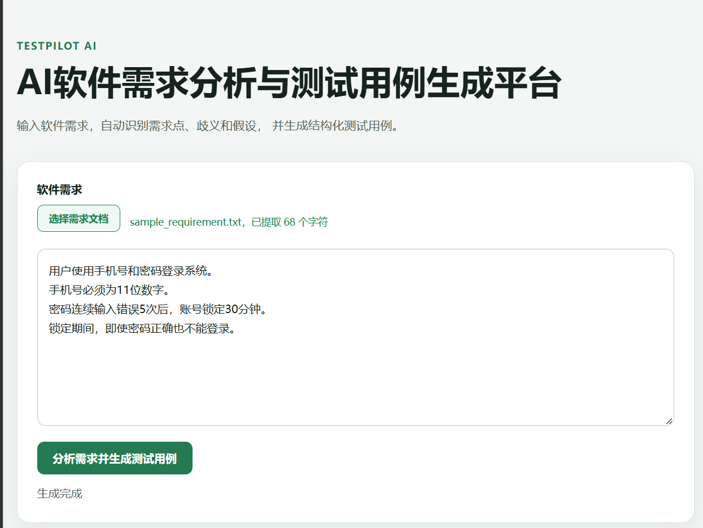
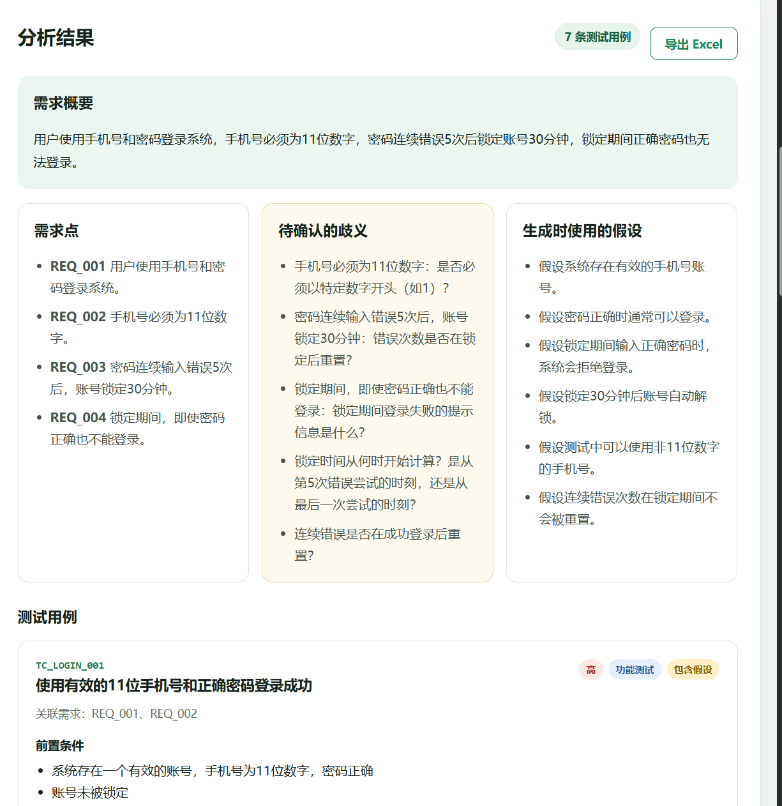
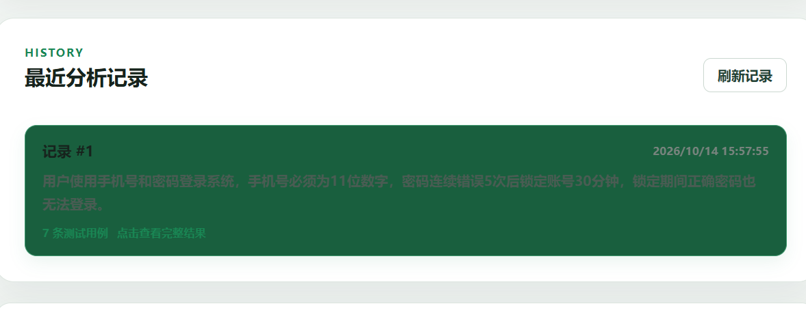

# TestPilot AI

一个基于 DeepSeek API 的软件需求分析与测试用例生成平台。

用户可以输入或上传软件需求文档，系统会自动识别需求点、歧义和假设，并生成结构化测试用例。生成结果支持历史记录查询和 Excel 导出。

## 功能

- 软件需求文本输入
- TXT、DOCX、PDF 文档解析
- AI 需求概要生成
- 需求点自动拆分
- 需求歧义识别
- 测试假设识别
- 结构化测试用例生成
- Pydantic 数据格式校验
- Excel 测试用例导出
- SQLite 历史记录保存
- 历史结果查看与再次导出
- FastAPI 在线接口文档

## 界面展示

### 需求输入与文档上传



### AI 需求分析与测试用例



### 历史记录



## 技术栈

### 后端

- Python
- FastAPI
- Pydantic
- SQLAlchemy
- SQLite
- DeepSeek API
- OpenAI Python SDK

### 前端

- HTML
- CSS
- JavaScript
- Fetch API

### 文档与表格处理

- openpyxl
- python-docx
- pypdf
- python-multipart

## 项目结构

```text
testpilot-ai/
├── frontend/
│   ├── index.html
│   ├── styles.css
│   └── app.js
├── api.py
├── database.py
├── deepseek_client.py
├── document_parser.py
├── excel_exporter.py
├── main.py
├── models.py
├── requirements.txt
├── .env.example
├── .gitignore
└── README.md
```

## 本地运行

### 1. 创建虚拟环境

```powershell
python -m venv .venv
```

### 2. 激活虚拟环境

Windows PowerShell：

```powershell
.venv\Scripts\Activate.ps1
```

### 3. 安装依赖

```powershell
python -m pip install -r requirements.txt
```

### 4. 配置环境变量

复制 `.env.example` 并将新文件命名为 `.env`：

```powershell
Copy-Item .env.example .env
```

在 `.env` 中填写 DeepSeek API Key：

```dotenv
DEEPSEEK_API_KEY=你的DeepSeek_API_Key
DEEPSEEK_BASE_URL=https://api.deepseek.com
DEEPSEEK_MODEL=deepseek-flash
```

请勿将真实 API Key 提交到 Git 仓库。

### 5. 启动服务

```powershell
python -m uvicorn api:app --reload --host 127.0.0.1 --port 8001
```

### 6. 访问系统

操作页面：

```text
http://127.0.0.1:8001
```

接口文档：

```text
http://127.0.0.1:8001/docs
```

## 主要接口

| 请求方式 | 接口 | 说明 |
|---|---|---|
| GET | `/health` | 检查服务运行状态 |
| POST | `/api/test-cases` | 分析需求并生成测试用例 |
| POST | `/api/export-excel` | 导出 Excel 文件 |
| POST | `/api/documents/extract` | 提取需求文档文字 |
| GET | `/api/history` | 获取历史记录列表 |
| GET | `/api/history/{history_id}` | 获取一条完整历史记录 |

## 支持的文档格式

| 格式 | 说明 |
|---|---|
| TXT | 支持 UTF-8 和常见中文编码 |
| DOCX | 提取段落和表格中的文字 |
| PDF | 提取包含文字层的 PDF 内容 |

上传文件大小不能超过 5MB。扫描版 PDF 暂不支持 OCR 识别。

## 核心处理流程

```text
用户输入或上传需求
        ↓
提取并清理需求文本
        ↓
调用 DeepSeek API
        ↓
生成结构化 JSON
        ↓
使用 Pydantic 校验
        ↓
保存历史记录
        ↓
网页展示或导出 Excel
```

## 数据安全

- DeepSeek API Key 保存在本地 `.env` 文件中。
- `.env` 已加入 `.gitignore`，不会提交到代码仓库。
- 本地 SQLite 数据库不会提交到代码仓库。
- 前端展示 AI 内容时使用安全的 DOM 文本写入方式。

## 后续计划

- 支持历史记录删除和搜索
- 支持测试用例在线编辑
- 支持测试类型和用例数量配置
- 增加用户登录与权限管理
- 增加 OCR 扫描文档识别
- 将 SQLite 切换为 MySQL
- 部署公开演示环境


## 在线体验

- 在线演示：https://testpilot-ai-uuhp.onrender.com
- API 文档：https://testpilot-ai-uuhp.onrender.com/docs

> 项目部署在 Render 免费实例上。长时间无人访问时服务会休眠，首次打开可能需要等待约一分钟。SQLite 历史记录可能在服务重启后重置。